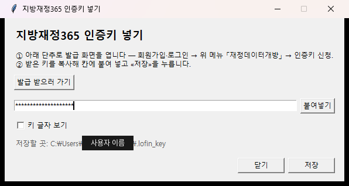

# kr-fiscal-stats

한국 재정·통계 공공 API 다섯 곳에서 자료를 조회해 표로 보여 주거나 CSV 파일로 저장하는 클로드 스킬입니다. API 주소나 통계표 코드를 몰라도 자연어로 요청하면 알맞은 자료원을 골라 받아 옵니다.

## 지원 자료

| 자료원 | 주요 내용 | 조회 방식 |
|---|---|---|
| 지방재정365 | 시·군·구 및 시·도 예산·결산·세입·세출·재정자립도·지방채·복지비 | 내장 목록(자료 146개, 항목 1,395칸) 및 자치단체 코드에서 선택 |
| 열린재정 | 중앙정부 예산·결산·국가채무·기금·부처별 집행 | 내장 목록(198종)에서 선택 |
| KOSIS 국가통계포털 | 인구·고용·사업체·가계·산업·국세 등 국가 공식 통계 | 국세통계는 내장 목록 사용, 그 외(약 29만 개 표)는 KOSIS 검색으로 탐색 |
| 한국은행 ECOS | 금리·물가·환율·통화·국민계정(GDP)·국제수지 | 내장 통계표 목록(617개)에서 선택 |
| 경기데이터드림 | 경기도 공개 자료(시설·인허가·지원사업·현황 목록 등) | 내장 목록(2,128개)에서 선택 |

- 지방세는 지방재정365, 국세는 KOSIS 국세통계에서 조회합니다.
- 국가 예산은 열린재정, 자치단체(경기도 시·군 포함) 예산은 지방재정365에서 조회합니다.

## 요구 사항

- **지원 환경**
  - 사용 가능: 클로드 코드(Claude Code), 클로드 데스크탑의 코드 탭 — 코드 탭은 **로컬** 세션에서 씁니다. 클라우드 세션은 홈 폴더의 키 파일을 읽지 못합니다(아래 [문제 해결](#문제-해결) 참고)
  - 제한적: 코덱스(CLI·앱) — 스킬 로드는 되나 외부 네트워크 접속이 기본 차단되어 있어 네트워크 허용이 필요함(세부 동작 미확인)
  - 사용 불가: 클로드 데스크탑 일반 채팅, ChatGPT 웹 — 스크립트가 클라우드에서 실행되어 로컬 인증키를 읽지 못함
- **파이썬 3**: 표준 라이브러리만 사용하므로 별도 패키지 설치는 필요하지 않습니다. [python.org](https://www.python.org/downloads/) 배포판 설치를 권장합니다.
  - Windows 설치 시 `Add python.exe to PATH`를 체크하고, 인증키 입력 창(tkinter) 사용을 위해 `tcl/tk and IDLE` 옵션을 유지하십시오.
  - macOS 기본 파이썬(`/usr/bin/python3`)은 창 표시 오류가 있을 수 있으므로 python.org 배포판을 권장합니다(Homebrew 파이썬 사용 시 `brew install python-tk` 필요).
- **인증키**: 사용할 자료원의 API 인증키만 발급받으면 됩니다.

## 설치 방법

### 클로드에게 설치 맡기기

클로드 코드나 클로드 데스크탑 코드 탭에서 아래처럼 요청하면 스킬 폴더 배치부터 인증키 입력 창 실행까지 안내받을 수 있습니다.

```text
https://github.com/Taeyeon1607/kr-fiscal-stats 의 스킬을 설치하고 인증키 넣는 창을 띄워 줘
```

### 수동 설치

저장소에서 내려받은 `kr-fiscal-stats` 폴더를 아래 경로에 넣은 뒤 새 대화(새 세션)를 엽니다.

| 대상 | Windows | macOS |
|---|---|---|
| 클로드 코드 / 데스크탑 코드 탭 | `C:\Users\<사용자이름>\.claude\skills\kr-fiscal-stats` | `~/.claude/skills/kr-fiscal-stats` |
| 코덱스 | `C:\Users\<사용자이름>\.agents\skills\kr-fiscal-stats` | `~/.agents/skills/kr-fiscal-stats` |

- `kr-fiscal-stats/SKILL.md`가 바로 보이도록 배치합니다(중첩 폴더 주의).
- 클로드 데스크탑 코드 탭에서 전역 경로를 읽지 못하면 작업 폴더 안의 `.claude/skills/kr-fiscal-stats`에 넣습니다.

## 인증키 설정

자료원별 발급 신청처와 환경변수/파일 이름은 아래와 같습니다. 화면별 발급 절차는 [`docs/kr-fiscal-stats-인증키-받기.pdf`](docs/kr-fiscal-stats-인증키-받기.pdf)를 참고하십시오.

| 자료원 | 발급처 | 환경변수 이름 | 홈 폴더 파일 이름 |
|---|---|---|---|
| 지방재정365 | https://www.lofin365.go.kr (재정데이터개방 → 인증키 신청) | `LOFIN_API_KEY` | `~/.lofin_key` |
| 열린재정 | https://www.openfiscaldata.go.kr/op/ko/ds/UOPKODSA01.do | `OPENFISCAL_API_KEY` | `~/.openfiscal_key` |
| KOSIS | https://kosis.kr/openapi/serviceUse/serviceUseUnityReg_01Detail.do | `KOSIS_API_KEY` | `~/.kosis_key` |
| 한국은행 ECOS | https://ecos.bok.or.kr/api/#/AuthKeyApply | `ECOS_API_KEY` | `~/.ecos_key` |
| 경기데이터드림 | https://data.gg.go.kr/portal/openapi/insertApikeyPage.do | `GGDREAM_API_KEY` | `~/.ggdream_key` |

### 인증키 입력 창 사용

클로드에게 `"지방재정365 키 넣어 줘"`처럼 요청하면 아래와 같은 로컬 입력 창이 뜹니다.



1. 아직 키가 없다면 창 안의 `발급 받으러 가기`를 눌러 발급 페이지를 엽니다.
2. 발급받은 키를 붙여넣고 `저장`을 누르면 홈 폴더의 `.<이름>_key` 파일에 한 줄로 저장됩니다.
3. 창에 입력한 키는 대화 기록에 남지 않으며 클로드에게도 노출되지 않습니다.

### 환경변수 또는 파일로 직접 설정

창을 띄울 수 없는 환경에서는 아래 방법 중 하나로 설정합니다(환경변수와 파일이 모두 있으면 환경변수가 우선합니다).

1. **클로드 `settings.json`**: `~/.claude/settings.json`(Windows는 `C:\Users\<사용자이름>\.claude\settings.json`)의 `env` 항목에 `"LOFIN_API_KEY": "발급받은 키"` 형태로 추가한 뒤 새 대화를 엽니다.
2. **운영체제 환경변수**: Windows 사용자 환경변수 또는 macOS `~/.zshrc`에 위 표의 환경변수 이름으로 등록합니다.
3. **홈 폴더 파일**: 홈 폴더(`~` 또는 `C:\Users\<사용자이름>`)에 위 표의 파일 이름(예: `.lofin_key`)으로 파일을 만들고 키 값만 한 줄 적어 저장합니다.

> **주의**: 인증키를 클로드 대화창에 직접 붙여넣거나 `kr-fiscal-stats` 스킬 폴더 안에 저장하지 마십시오. 대화창에 입력한 키는 즉시 폐기 후 재발급받는 것이 안전합니다.

## 사용 예

새 대화를 열고 필요한 자료를 자연어로 요청합니다. 먼저 1건을 시험 조회해 항목과 단위를 확인한 뒤 전체 자료를 받으며, 저장된 CSV 파일은 엑셀에서 한글 깨짐 없이 바로 열립니다.

- `"2024년 수원시 재정자립도 받아 줘"` (지방재정365)
- `"2020년부터 국가채무 추이 표로 보여 줘"` (열린재정)
- `"최근 5년 세목별 국세 징수액 받아 줘"` (KOSIS 국세통계)
- `"올해 한국은행 기준금리 추이 보여 줘"` (한국은행 ECOS)
- `"경기도 시군별 2024년 세출예산을 엑셀 파일로 저장해 줘"` (지방재정365, CSV 저장)

## 문제 해결

| 증상 | 해결 방법 |
|---|---|
| 인증키가 없다는 안내 | 위 [인증키 설정](#인증키-설정)에 따라 해당 자료원의 키를 등록합니다. |
| 클로드 데스크탑 코드 탭의 **클라우드** 세션에서 인증키가 없다는 안내 | 클라우드 세션은 내 PC 의 홈 폴더 키 파일을 읽지 못합니다. **새 대화를 로컬 세션으로 여십시오.** 클라우드 환경의 `네트워크 시크릿`은 키를 요청 헤더로만 붙여 주는데, 이 스킬의 다섯 곳은 키를 요청 주소에 넣으므로 쓸 수 없습니다. 데스크탑 앱의 클라우드 환경 화면에는 환경 변수 칸이 없습니다(2026-10 기준). |
| `"○○ 에 닿지 못했습니다"` | 네트워크 차단 상태입니다. 클로드 데스크탑은 `설정 → 기능 → 외부 네트워크 접속 허용`을 켜고 `추가 허용 도메인`에 해당 도메인(`www.lofin365.go.kr`, `openapi.openfiscaldata.go.kr`, `kosis.kr`, `ecos.bok.or.kr`, `openapi.gg.go.kr`, 목록 대조 시 `www.openfiscaldata.go.kr`)을 등록한 뒤 새 대화를 엽니다. |
| 조회 결과 0건 | 연도·지역 조건을 바꾸어 보거나, KOSIS 조회 시 검색어를 짧게 줄여(예: `"사업체"`) 다시 요청합니다. |
| `"이 자리에서는 창을 못 띄웁니다"` | tkinter 미설치 또는 클라우드 실행 환경입니다. python.org 배포판을 설치하거나 환경변수·파일 방식으로 직접 키를 넣습니다. |
| 찾는 자료가 목록에 없음 | 사이트 목록이 바뀌었을 수 있습니다. 클로드에게 `"목록 대조해 줘"`라고 요청해 최신 목록과 대조합니다. |
| SSL 인증서 확인 실패 | 사내망·기관 PC의 인증서 저장소 문제이므로 전산 담당자에게 문의합니다. |
| Windows에서 `python3` 실행 오류 | 클로드에게 `"윈도우라 python 으로 돌려 줘"`라고 요청하거나 파이썬 PATH 설정을 확인합니다. |

## 자료 출처와 이용 조건

- **출처 표기**: 조회한 자료를 외부에 인용할 때는 `출처: 기관명(통계표·자료명), 조회일` 형식으로 출처를 밝혀야 합니다. KOSIS와 ECOS는 출처 표기가 필수이며, ECOS 내 타 기관 통계표는 비상업적 이용만 허용됩니다. 경기데이터드림 자료의 상업적 이용은 경기도 사전 승인이 필요합니다. 기관별 상세 이용 조건은 [`NOTICE`](NOTICE)를 참고하십시오.
- **검산 유의 사항**: API 응답에는 금액 단위가 대개 적혀 있지 않습니다. 클로드가 수치 크기로 단위를 추정하면 «추정»이라고 밝히므로, 보고서에 쓰기 전에 원 사이트에서 단위를 확인하십시오. 합산·비율 등 가공 수치는 원자료와 구분해 확인하고, 예산/결산 및 당초/최종 여부도 함께 대조하십시오.
- 더 자세한 설명은 [`kr-fiscal-stats/설치와-사용.md`](kr-fiscal-stats/설치와-사용.md)에 있습니다.

## 라이선스

- **코드 및 문서** (`scripts/`, `SKILL.md`, `설치와-사용.md`, `README.md`): MIT 라이선스를 따릅니다([`LICENSE`](LICENSE)).
- **자료 목록 파일** (`kr-fiscal-stats/references/` 내 기관별 목록): MIT 라이선스 적용 대상이 아닙니다. 저작권은 각 제공 기관에 있으며, 이용 조건과 출처는 [`NOTICE`](NOTICE)에 정리되어 있습니다.
